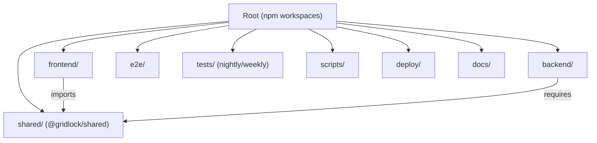

# Design Document: Repo Structure Cleanup

## Overview

This design describes the restructuring of the GridLock monorepo to follow industry-standard conventions. The restructuring is a series of coordinated file moves, configuration changes, and import path updates that transform the current flat/ad-hoc layout into a well-organized, navigable structure.

The restructuring is executed as a single atomic effort — all changes are made together to avoid intermediate broken states. The key outcomes are:

1. **Clean root directory** — only essential config and docs at the top level
2. **Feature-grouped components** — frontend components organized by domain
3. **Unified test structure** — predictable test locations for each runner
4. **Shared constants package** — single source of truth for cross-package values
5. **Consistent tooling** — Prettier formatting, npm workspaces, unified env config

## Architecture

The restructuring preserves the existing monorepo architecture (frontend + backend as separate packages) while adding a third `shared/` package and enabling npm workspaces for cross-package linking.



### Target Directory Layout

```
GridLock/
├── .github/                    # GitHub templates, CODEOWNERS
├── .husky/                     # Git hooks (pre-commit with Prettier + ESLint)
├── .vscode/                    # Editor settings
├── backend/                    # Node.js + Express + Socket.IO server
│   ├── __tests__/              # Jest tests (unit + integration)
│   │   └── legacy/            # Relocated ad-hoc test scripts
│   ├── config/
│   ├── constants/
│   ├── controllers/handlers/
│   ├── lib/
│   ├── middleware/
│   ├── models/
│   ├── routes/
│   ├── services/
│   ├── stores/
│   └── utils/
├── deploy/                     # Deployment configs
│   └── ecosystem.config.js    # PM2 config (relocated)
├── docs/                       # Project documentation
│   └── planning/              # Planning docs (relocated from root)
├── e2e/                        # Primary Playwright E2E specs
├── frontend/                   # React + Vite SPA
│   └── src/
│       ├── components/
│       │   ├── auth/          # Auth components
│       │   ├── chat/          # Chat components (existing)
│       │   ├── daily/         # Daily challenge components
│       │   ├── game/          # Game components
│       │   ├── lobby/         # Lobby components (existing)
│       │   ├── shared/        # Cross-cutting components
│       │   ├── social/        # Social feature components
│       │   └── tournament/    # Tournament components
│       ├── contexts/
│       ├── hooks/
│       ├── lib/
│       ├── tests/             # Vitest unit/component tests
│       ├── themes/
│       └── utils/
├── scripts/                    # Utility scripts
│   ├── qa-screenshots/        # QA screenshot tool (relocated)
│   └── design-audit/
├── shared/                     # @gridlock/shared package
│   ├── constants/
│   │   └── socketEvents.js
│   └── package.json
├── tests/                      # Scheduled test suites
│   ├── nightly/
│   ├── weekly/
│   ├── playwright.nightly.config.js
│   └── playwright.weekly.config.js
├── .env.example                # Unified env var documentation
├── .prettierrc                 # Prettier config
├── .prettierignore             # Prettier ignore patterns
├── package.json                # Root workspace config
├── playwright.config.js        # Primary E2E config
├── CHANGELOG.md
├── DEVELOPMENT.md
├── README.md
└── INFRASTRUCTURE.md
```

## Components and Interfaces

### Component 1: File Removal Module

Removes stale/dead files from the repository.

**Files to delete:**
- `backend/server.js.backup` — stale backup
- `.gitkeep` at root — purposeless (directory has content)
- `frontend/before-test.js` — if exists
- `frontend/design-spec.json` — if exists

**Interface:** Shell commands (`git rm` or `rm`) executed in sequence.

### Component 2: Planning Docs Relocation

Moves planning markdown files from root to `docs/planning/`.

**Files to move:**
| Source | Destination |
|--------|-------------|
| `4PLAYER_NEXT_STEPS.md` | `docs/planning/4PLAYER_NEXT_STEPS.md` |
| `4PLAYER_SUMMARY.md` | `docs/planning/4PLAYER_SUMMARY.md` |
| `BETA_PROGRESS.md` | `docs/planning/BETA_PROGRESS.md` |
| `PRODUCTION_CHECKLIST.md` | `docs/planning/PRODUCTION_CHECKLIST.md` |
| `VERSIONING.md` | `docs/planning/VERSIONING.md` |

**Interface:** `git mv` commands. No content modification.

### Component 3: Backend Test Consolidation

Moves legacy ad-hoc test scripts into the organized test directory.

**Files to move:**
| Source | Destination |
|--------|-------------|
| `backend/test-4player-logic.js` | `backend/__tests__/legacy/test-4player-logic.js` |
| `backend/test-5x5-grid.js` | `backend/__tests__/legacy/test-5x5-grid.js` |
| `backend/test-avatars.js` | `backend/__tests__/legacy/test-avatars.js` |
| `backend/test-e2e-flow.js` | `backend/__tests__/legacy/test-e2e-flow.js` |
| `backend/test-game-flow.js` | `backend/__tests__/legacy/test-game-flow.js` |
| `backend/test-socket.js` | `backend/__tests__/legacy/test-socket.js` |

**Configuration update:** `backend/package.json` scripts:
```json
{
  "test:legacy": "node __tests__/legacy/test-4player-logic.js && node __tests__/legacy/test-5x5-grid.js && node __tests__/legacy/test-game-flow.js",
  "test:all": "jest --runInBand && node __tests__/legacy/test-4player-logic.js && node __tests__/legacy/test-5x5-grid.js && node __tests__/legacy/test-game-flow.js && node __tests__/legacy/test-avatars.js && node __tests__/legacy/test-e2e-flow.js"
}
```

### Component 4: Frontend Component Reorganization

Groups flat component files into feature subdirectories.

**Mapping:**

| Subdirectory | Components |
|---|---|
| `game/` | `Board.jsx`, `GameController.jsx`, `ScoreBar.jsx`, `WaitingRoom.jsx`, `QuickPlay.jsx`, `RankedQueue.jsx`, `ReplayPage.jsx`, `PostGameStatsCard.jsx`, `GameDemo.jsx` |
| `auth/` | `AuthAvatar.jsx`, `AuthNudge.jsx`, `AuthSetup.jsx` |
| `social/` | `Profile.jsx`, `Leaderboard.jsx`, `GameHistory.jsx`, `RecentOpponents.jsx` |
| `tournament/` | `TournamentLobby.jsx`, `Bracket.jsx`, `ChallengePage.jsx` |
| `daily/` | `DailyChallenge.jsx`, `DailyLeaderboard.jsx`, `DailyResult.jsx` |
| `shared/` | `ErrorBoundary.jsx`, `ConnectionOverlay.jsx`, `BottomNav.jsx`, `ThemeToggle.jsx`, `ScrollToTop.jsx`, `SentryFallback.jsx`, `PageSeo.jsx`, `HeroBanner.jsx`, `HowToPlay.jsx`, `HowToPlay.css` |
| `lobby/` | `Lobby.jsx`, `JoinGame.jsx` (already partially organized) |

**Remaining in root `components/`:**
- `RankBadge.jsx` — used across multiple features, stays in `shared/`
- `Settings.jsx`, `SoundSettings.jsx` — could go in a `settings/` subdirectory or `shared/`

**Import path update strategy:**
1. Use IDE-assisted refactoring or a script to find all imports of moved components
2. Update each import path from `../components/X` to `../components/{feature}/X`
3. Update `App.jsx` lazy-load paths
4. Update test file imports in `frontend/src/components/__tests__/`

**Decision:** Component test files in `frontend/src/components/__tests__/` will be co-located with their feature subdirectories (e.g., `frontend/src/components/game/__tests__/Board.test.jsx`) to maintain proximity between source and test.

### Component 5: Shared Constants Package

Creates a new `shared/` package at root for cross-package constants.

**`shared/package.json`:**
```json
{
  "name": "@gridlock/shared",
  "version": "2.1.0",
  "description": "Shared constants and types for GridLock frontend and backend",
  "main": "index.js",
  "license": "ISC"
}
```

**`shared/constants/socketEvents.js`:**
```javascript
/**
 * Socket.IO event name constants shared between frontend and backend.
 *
 * Usage (backend - CommonJS):
 *   const { EVENTS } = require('@gridlock/shared/constants/socketEvents');
 *
 * Usage (frontend - ES Modules via npm workspace symlink):
 *   import { EVENTS } from '@gridlock/shared/constants/socketEvents';
 *   (Vite resolves workspace symlinks automatically)
 */

const EVENTS = {
  // Game lifecycle
  CREATE_GAME: 'create_game',
  JOIN_GAME: 'join_game',
  LEAVE_GAME: 'leave_game',
  GAME_STARTED: 'game_started',
  GAME_UPDATE: 'game_update',
  GAME_OVER: 'game_over',

  // Moves
  MAKE_MOVE: 'make_move',

  // Lobby
  WAITING_FOR_PLAYERS: 'waiting_for_players',
  PLAYER_JOINED: 'player_joined',
  PLAYER_LEFT: 'player_left',

  // Chat
  SEND_CHAT_MESSAGE: 'send_chat_message',
  CHAT_MESSAGE: 'chat_message',
  CHAT_HISTORY: 'chat_history',

  // Tournament
  START_TOURNAMENT: 'start_tournament',
  JOIN_TOURNAMENT: 'join_tournament',
  TOURNAMENT_UPDATE: 'tournament_update',
  TOURNAMENT_STARTED: 'tournament_started',

  // Ranked
  JOIN_RANKED_QUEUE: 'join_ranked_queue',
  LEAVE_RANKED_QUEUE: 'leave_ranked_queue',
  RANKED_MATCH_FOUND: 'ranked_match_found',

  // Matchmaking
  QUICK_PLAY: 'quick_play',

  // Spectator
  SPECTATE_GAME: 'spectate_game',
  LEAVE_SPECTATE: 'leave_spectate',

  // System
  ERROR: 'error',
  DISCONNECT: 'disconnect',
  RECONNECT: 'reconnect',
};

module.exports = { EVENTS };
```

**`shared/index.js`:**
```javascript
const { EVENTS } = require('./constants/socketEvents');
module.exports = { EVENTS };
```

**Frontend compatibility:** Vite resolves npm workspace symlinks natively. The frontend can import from `@gridlock/shared/constants/socketEvents` using ES module syntax because Vite handles the CommonJS-to-ESM conversion during bundling.

### Component 6: Environment Variable Unification

Merges `backend/.env.example` into the root `.env.example` and removes the backend copy.

**Unified `.env.example` structure:**
```dotenv
# ═══════════════════════════════════════════════════════════════
# GridLock — Environment Variables (Single Source of Truth)
# ═══════════════════════════════════════════════════════════════
# Both frontend (Vite) and backend (dotenv) read from this file.
# Backend loads via: require('dotenv').config({ path: '../.env' })

# ── Server ──────────────────────────────────────────────────────
NODE_ENV=production          # production | development
PORT=5000                    # Backend server port
LOG_LEVEL=INFO               # DEBUG | INFO | WARN | ERROR

# ── Database ────────────────────────────────────────────────────
MONGO_URI=mongodb://localhost:27017/gridlock  # Required

# ── Redis (optional) ───────────────────────────────────────────
REDIS_URL=                   # redis://localhost:6379 (optional, falls back to in-memory)

# ── Auth (Google OAuth) ────────────────────────────────────────
GOOGLE_CLIENT_ID=            # Required
GOOGLE_CLIENT_SECRET=        # Required
GOOGLE_REDIRECT_URI=http://localhost:5000/api/auth/google/callback
JWT_SECRET=                  # Required — generate: node -e "console.log(require('crypto').randomBytes(64).toString('hex'))"

# ── CORS ───────────────────────────────────────────────────────
CORS_ORIGIN=                 # Comma-separated origins (required in production)
FRONTEND_URL=http://localhost:5173  # For OAuth redirects

# ── Push Notifications (VAPID) ─────────────────────────────────
VAPID_PUBLIC_KEY=            # Generate: npx web-push generate-vapid-keys
VAPID_PRIVATE_KEY=           # Required for push
VAPID_EMAIL=mailto:noreply@gridlock.app

# ── Monitoring ─────────────────────────────────────────────────
SENTRY_DSN=                  # Optional — Sentry error tracking

# ── Admin ──────────────────────────────────────────────────────
ADMIN_API_KEY=               # For protected endpoints — generate: openssl rand -hex 32

# ── Infrastructure ─────────────────────────────────────────────
# TRUSTED_PROXY_IPS=         # Comma-separated IPs for X-Forwarded-For parsing
```

**Backend `server.js` change:** Update dotenv config to load from root:
```javascript
require('dotenv').config({ path: require('path').resolve(__dirname, '../.env') });
```

### Component 7: Prettier Configuration

**`.prettierrc`:**
```json
{
  "singleQuote": true,
  "semi": true,
  "trailingComma": "all",
  "tabWidth": 2,
  "printWidth": 100,
  "arrowParens": "always",
  "endOfLine": "lf"
}
```

**`.prettierignore`:**
```
node_modules/
dist/
build/
coverage/
playwright-report/
*.min.js
package-lock.json
frontend/package-lock.json
backend/package-lock.json
```

**Root `package.json` scripts:**
```json
{
  "format": "prettier --write .",
  "format:check": "prettier --check ."
}
```

**Updated `.husky/pre-commit`:**
```sh
#!/bin/sh
set -e

# Format staged files with Prettier
STAGED_FILES=$(git diff --cached --name-only --diff-filter=d)
if [ -n "$STAGED_FILES" ]; then
  echo "💅 Checking formatting on staged files..."
  echo "$STAGED_FILES" | tr '\n' '\0' | xargs -0 npx prettier --check --ignore-unknown
fi

# Lint only staged frontend files
STAGED_FRONTEND=$(git diff --cached --name-only --diff-filter=d -- 'frontend/src/**/*.js' 'frontend/src/**/*.jsx' | sed 's|^frontend/||')
if [ -n "$STAGED_FRONTEND" ]; then
  echo "🔍 Linting staged frontend files..."
  (cd frontend && echo "$STAGED_FRONTEND" | tr '\n' '\0' | xargs -0 npx eslint --quiet)
fi

# Run backend tests if any backend files are staged
STAGED_BACKEND=$(git diff --cached --name-only --diff-filter=d -- 'backend/**')
if [ -n "$STAGED_BACKEND" ]; then
  echo "🧪 Running backend tests..."
  (cd backend && npm test --silent)
fi

echo "✅ Pre-commit checks passed"
```

### Component 8: npm Workspaces Configuration

**Root `package.json` additions:**
```json
{
  "workspaces": ["frontend", "backend", "shared"]
}
```

After adding workspaces, running `npm install` from root will:
1. Install all dependencies for frontend, backend, and shared
2. Create a symlink for `@gridlock/shared` in `node_modules/`
3. Allow both frontend and backend to import from `@gridlock/shared`

### Component 9: QA Screenshots and PM2 Relocation

**QA Screenshots:** Move `qa-screenshots/` → `scripts/qa-screenshots/`

**PM2 Config:** Move `ecosystem.config.js` → `deploy/ecosystem.config.js`

**Script updates:**
- Root `package.json` `visual-qa` script: update path reference
- Deploy scripts in `scripts/`: update `ecosystem.config.js` path references

### Component 10: Playwright Configuration Consolidation

The current setup is already well-organized:
- Root `playwright.config.js` targets `./e2e/`
- `tests/playwright.nightly.config.js` targets `tests/nightly/`
- `tests/playwright.weekly.config.js` targets `tests/weekly/`

**Action:** Check if `frontend/playwright.config.js` exists and remove it if so. Verify root config scripts clearly indicate which config they use.

### Component 11: Vitest Exclusion Configuration

Update `frontend/vite.config.js` test section to exclude Playwright specs:
```javascript
test: {
  globals: true,
  environment: 'jsdom',
  setupFiles: './src/tests/setup.js',
  css: false,
  exclude: ['**/node_modules/**', '**/e2e/**', '**/*.spec.js'],
},
```

## Data Models

This feature does not introduce new data models or modify existing database schemas. All changes are structural (file locations, configuration, import paths).

**Affected configuration files:**

| File | Change Type |
|------|-------------|
| `package.json` (root) | Add workspaces, format scripts, update devDependencies |
| `backend/package.json` | Update test:legacy and test:all script paths |
| `frontend/vite.config.js` | Add Vitest exclude patterns |
| `backend/server.js` | Update dotenv path |
| `.husky/pre-commit` | Add Prettier check |
| `.prettierrc` | New file |
| `.prettierignore` | New file |
| `shared/package.json` | New file |
| `deploy/ecosystem.config.js` | Relocated file |

## Error Handling

### Risk: Broken Import Paths

**Mitigation:** After moving frontend components, run `cd frontend && npm run build` to catch any unresolved imports at compile time. Vite's build will fail fast on missing modules.

### Risk: Circular Dependencies in Shared Package

**Mitigation:** The shared package only exports constants (string literals). No logic, no dependencies on frontend or backend code. This eliminates circular dependency risk.

### Risk: npm Workspace Hoisting Conflicts

**Mitigation:** Both frontend and backend already have their own `package-lock.json`. After enabling workspaces, run `npm install` from root and verify no version conflicts. If hoisting causes issues, use `overrides` in root `package.json` or add problematic packages to `nohoist` patterns.

### Risk: Legacy Test Scripts Break After Move

**Mitigation:** Legacy test scripts use relative paths for `require()`. After moving to `__tests__/legacy/`, update any relative paths within those scripts (e.g., `require('../utils/gameLogic')` becomes `require('../../utils/gameLogic')`).

### Risk: PM2 Config Path Change Breaks Deployment

**Mitigation:** The PM2 config uses absolute paths (`/home/ubuntu/projects/...`) for `cwd`, so the file's own location doesn't affect runtime behavior. Update deploy scripts to reference `deploy/ecosystem.config.js` and document the change in `INFRASTRUCTURE.md`.

### Rollback Strategy

All changes are committed as a single branch. If issues arise:
1. `git revert` the merge commit to restore previous structure
2. Individual file moves can be reverted with `git checkout <commit> -- <path>`

## Testing Strategy

### Why Property-Based Testing Does Not Apply

This feature is a **structural reorganization** — it moves files, updates configuration, and rewrites import paths. There is no algorithmic logic, no data transformation, and no function with varying inputs that could benefit from property-based testing.

The acceptance criteria are all of the form:
- "File X SHALL exist at location Y" → smoke test
- "File Z SHALL NOT exist at location W" → smoke test
- "Config field F SHALL contain value V" → example-based test
- "Build/test commands SHALL pass" → integration test

None of these vary meaningfully with input or benefit from 100+ iterations.

### Testing Approach

**1. Build Verification (Integration)**
- `cd frontend && npm run build` — confirms all import paths resolve
- `cd backend && npm test` — confirms backend tests still pass
- `cd frontend && npm run test` — confirms frontend tests still pass
- `cd frontend && npx eslint .` — confirms no new lint errors

**2. Structure Verification (Smoke Tests)**
- Verify stale files are deleted (file existence checks)
- Verify planning docs exist in `docs/planning/`
- Verify legacy tests exist in `backend/__tests__/legacy/`
- Verify component subdirectories exist with expected files
- Verify `shared/` package is importable from both frontend and backend

**3. Configuration Verification (Example-Based)**
- Verify root `package.json` has `workspaces` field
- Verify `.prettierrc` exists with correct settings
- Verify `format` and `format:check` scripts work
- Verify `npm install` from root succeeds with workspace linking
- Verify `backend/server.js` loads env from root `.env`

**4. Manual Verification Checklist**
- Start backend locally, confirm it connects to MongoDB
- Start frontend dev server, confirm proxy works
- Run `npm run format:check` to verify Prettier config
- Run a sample E2E test to confirm Playwright config is correct

### Test Execution Order

1. Run all existing tests BEFORE restructuring (baseline)
2. Execute restructuring
3. Run all existing tests AFTER restructuring (regression)
4. Run structure verification checks
5. Manual smoke test of dev workflow
