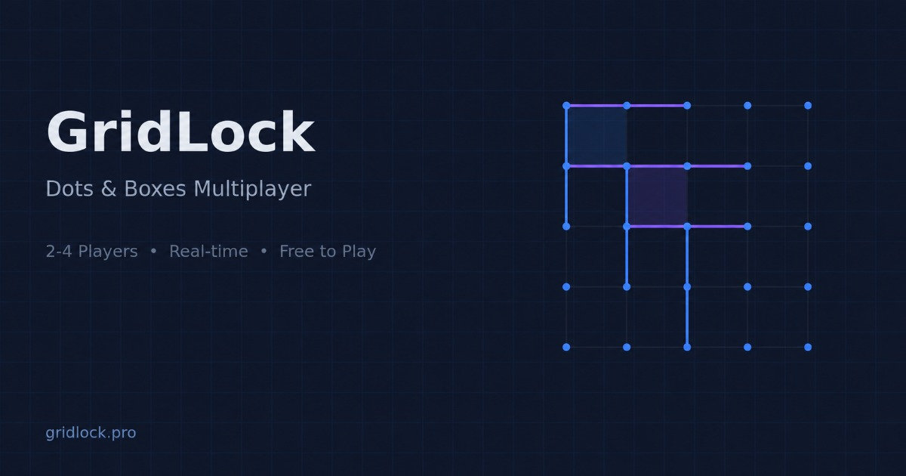

<div align="center">

# GridLock

**Free online Dots & Boxes for 2–4 players.** Challenge friends in a private room, practice against the CPU, or try the daily puzzle in your browser.

[](https://github.com/DhananjayThomble/GridLock/actions/workflows/ci.yml)
[](LICENSE)
[](CONTRIBUTING.md)

**[Play GridLock](https://gridlock.pro/)** · [How to play](https://gridlock.pro/how-to-play) · [Learn how it’s built](LEARN.md) · [Find a good first issue](https://github.com/DhananjayThomble/GridLock/issues?q=is%3Aissue+is%3Aopen+label%3A%22good+first+issue%22)

[](https://gridlock.pro/)

</div>

---

## What is it?

Dots & Boxes is the classic pen-and-paper game: take turns drawing a line between two dots. Close the fourth side of a box and you claim it **and move again**. Most boxes wins.

GridLock is an installable browser game. The server validates each move and publishes the updated board, turn, and score to everyone in the room.

## Features

- **Real-time multiplayer:** Socket.IO rooms for 2–4 players, shareable via game ID, QR code or challenge link.
- **Play your way:** private rooms, quick play, CPU opponents (easy to hard), ranked matchmaking with Elo, tournaments and a daily challenge.
- **Server-authoritative:** move validation, turn order and scoring all run on the backend.
- **Accounts or guests:** optional Google sign-in; guest progress carries over when you sign up.
- **Progression:** leaderboard, profile, game history with replays, unlockable grid themes.
- **Polished UX:** responsive and touch-friendly, in-game chat, sound, light/dark mode.
- **PWA:** installable, with optional Web Push turn notifications.
- **Scales out:** optional Redis adapter for multiple server instances.

## Tech stack

| Layer | Tools |
|---|---|
| Frontend | React 19, Vite 7, Tailwind CSS, React Router 7, Socket.IO client |
| Backend | Node.js 22, Express 5, Socket.IO 4, Mongoose (MongoDB), optional Redis |
| Auth & push | Google OAuth + JWT cookies, Web Push (VAPID) |
| Testing | Jest (backend), Vitest (frontend), Playwright (E2E) |
| Ops | PM2, Nginx, GitHub Actions |

## Quick start

**Prerequisites:** Node.js 22 (`nvm use` reads `.nvmrc`) and a MongoDB instance (local or Atlas). Redis is optional.

```bash
git clone https://github.com/DhananjayThomble/GridLock.git
cd GridLock

# Backend (http://localhost:5000)
cd backend
npm ci
cp .env.example .env      # set MONGO_URI at minimum
npm start

# Frontend (http://localhost:5173), in a second terminal
cd frontend
npm ci
cp .env.example .env      # the defaults work for local dev
npm run dev
```

Open <http://localhost:5173>, create a game, and join from a second tab to try it out. Vite proxies `/api` and `/socket.io` to the backend, so the frontend `.env` can stay empty locally.

### Configuration

Everything beyond `MONGO_URI` is optional. Features switch on when their variables are set.

| Variable | Where | Purpose |
|---|---|---|
| `MONGO_URI` | backend | MongoDB connection string |
| `REDIS_URL` | backend | Enable the Redis adapter for multi-instance scaling |
| `CORS_ORIGIN` | backend | Allowed origins, comma-separated |
| `GOOGLE_CLIENT_ID` / `GOOGLE_CLIENT_SECRET` / `JWT_SECRET` | backend | Google sign-in |
| `VAPID_PUBLIC_KEY` / `VAPID_PRIVATE_KEY` | backend | Push notifications (`npx web-push generate-vapid-keys`) |
| `VITE_SOCKET_URL` / `VITE_API_BASE_URL` | frontend | Backend URL when it runs on another origin |
| `VITE_SENTRY_DSN` / `VITE_POSTHOG_KEY` | frontend | Error tracking and analytics, off unless set |

See [`backend/.env.example`](backend/.env.example) and [`frontend/.env.example`](frontend/.env.example) for the full lists.

## Testing

```bash
npm ci                                  # root Playwright dependencies
npm --prefix backend test                # Jest
npm --prefix frontend test               # Vitest
npm --prefix frontend run lint
npx playwright install chromium
npm run test:e2e:local -- e2e/11-share-result.spec.js
```

The local browser suite needs MongoDB on port 27017. CI runs backend and frontend tests, lint, the production build, and a desktop and mobile gameplay smoke test on pull requests into `develop` or `main`.

## Project layout

```
backend/    Express + Socket.IO server (routes, controllers, models, services, stores)
frontend/   React app (components, contexts, hooks, themes)
e2e/        Playwright end-to-end tests
scripts/    Build, deploy and release tooling
docs/       Architecture notes and audits
```

## Deploying

GitHub Actions builds and tests off-box, then ships to a small server over an SSH key locked to a single deploy script. Nothing heavy builds on the server, so a small VPS is enough. Setup is in [INFRASTRUCTURE.md](INFRASTRUCTURE.md); for HTTPS/WSS and Nginx hardening see [docs/SECURITY-NGINX.md](docs/SECURITY-NGINX.md).

## Contributing

Try the game and [star the repository](https://github.com/DhananjayThomble/GridLock) if you’d like to follow its development. Contributions are welcome, from typo fixes to new features. Read [CONTRIBUTING.md](CONTRIBUTING.md) first (branch from `develop`, Conventional Commits, tests for new behavior) and follow the [Code of Conduct](CODE_OF_CONDUCT.md). Release history is in [CHANGELOG.md](CHANGELOG.md).

## Privacy and security

See [Privacy on GridLock](https://gridlock.pro/privacy/) for the hosted game’s data practices and account deletion.

Found a vulnerability? Please report it privately. See [SECURITY.md](SECURITY.md).

## License

[MIT](LICENSE) © 2026 Dhananjay Thomble
